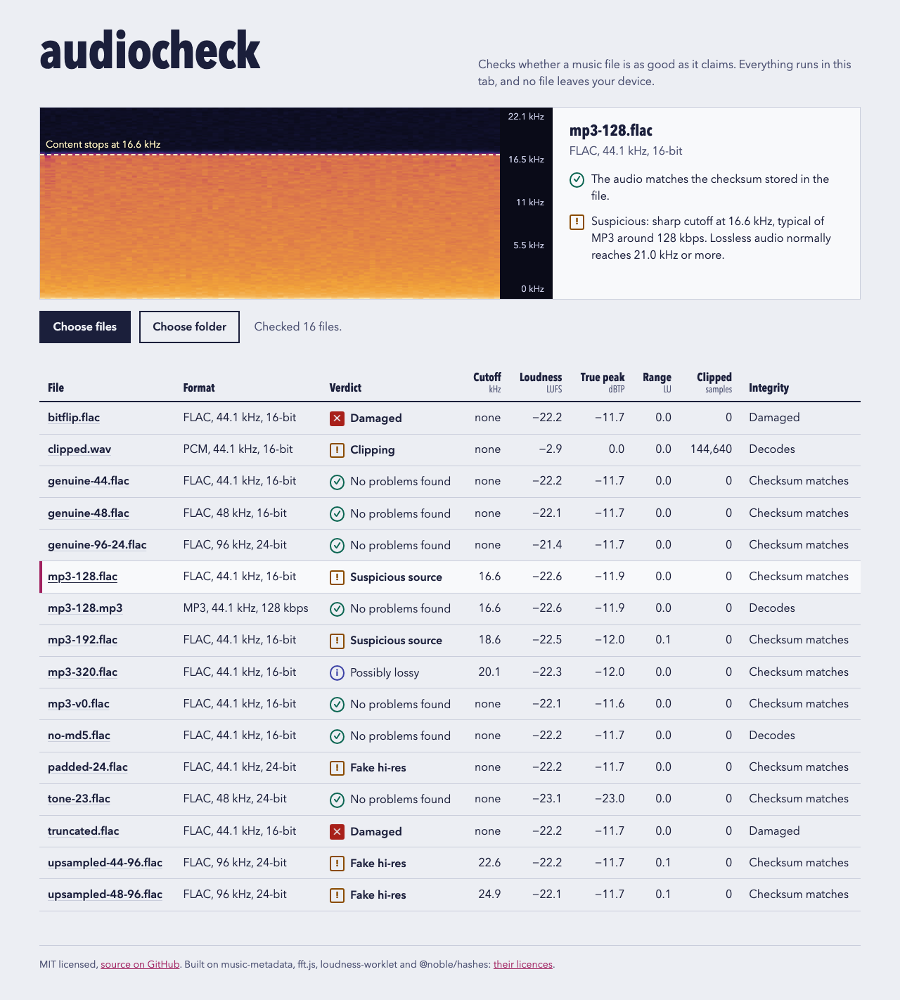

<div align="center">


# audiocheck

**Checks whether a music file is as good as it claims, in your browser. No file leaves your device.**

[Use it](#use-it) · [What it checks](#what-it-checks) · [Limits](#limits) · [Privacy](#privacy) · [Run it locally](#run-it-locally) · [Credits](#credits-and-licences)

[](https://github.com/Gitguy268/audiocheck/actions/workflows/ci.yml)




</div>

`Gitguy268/audiocheck` is a single web page. Drop audio files or a whole folder on it and each file gets a spectrogram, a set of measurements and a verdict in plain words: an MP3 dressed up as FLAC, a "hi-res" file that is upsampled CD audio, a track that clips, a file that is damaged.

The files in the screenshot are generated test signals (noise and sine tones), not music.

## Use it

Open <https://gitguy268.github.io/audiocheck/>, then drop files or a folder on the page, or use **Choose files** / **Choose folder**. Click a file name in the table to see its spectrogram and findings.

It decodes with the browser's own decoder, so it reads what your browser can play. FLAC, WAV and MP3 are covered by the tests; Ogg Vorbis, Opus and AAC/M4A depend on the browser. For formats the browser cannot decode (ALAC in Chromium browsers, APE, WavPack, DSD) it shows the header details and says so.

## What it checks

| Check | What you get | How |
| --- | --- | --- |
| **Lossy source** | "Suspicious: sharp cutoff at 16.6 kHz, typical of MP3 around 128 kbps" | Lossy encoders cut off the top of the spectrum. A sharp edge with nothing above it, well below where lossless audio normally ends, is their fingerprint. |
| **Fake hi-res** | "Upsampled: content stops at 22.6 kHz in a 96 kHz file", "24-bit file holding 16-bit audio" | A 96 kHz file with nothing above CD range was upsampled. A 24-bit file whose lowest 8 bits are zero in every sample is padded 16-bit audio. |
| **Loudness and clipping** | Integrated loudness (LUFS), loudness range (LU), true peak (dBTP), clipped samples | ITU-R BS.1770 metering, plus a count of flat tops: three or more samples in a row stuck at the file's maximum. |
| **Integrity** | "Cut short", "The audio does not match the checksum stored in the file" | The decoded length is compared with the header. For FLAC, the MD5 of the decoded samples is compared with the MD5 stored in the file. |

Verdicts are worded as evidence, never as a flat "fake". Some real recordings have little treble, and some masters are filtered at 20 kHz.

| Verdict | Meaning |
| --- | --- |
| No problems found | Nothing above tripped. This is not proof of a lossless source; see [Limits](#limits). |
| Suspicious source | A lossless file with an encoder-style cutoff below 19.5 kHz, or a lossy file whose cutoff is far too low for its bitrate. |
| Possibly lossy | A sharp cutoff between 19.5 and 21 kHz. MP3 at 256 to 320 kbps cuts there, but so do some masters. |
| Fake hi-res | Upsampled, or bit depth padded. |
| Clipping | Five or more flat tops. |
| Peaks over full scale | True peak above 0 dBTP: the waveform between samples exceeds full scale. |
| Damaged | Cut short, samples missing, checksum mismatch, or it does not decode. |

<details>
<summary><strong>How each check works</strong></summary>

**Decoding.** The header is read with music-metadata. The file is then decoded by the browser into an `OfflineAudioContext` created at the file's own sample rate, so nothing is resampled.

**Spectrum and cutoff.** The audio is cut into 8192-sample frames with a Hann window (at most 6000 frames, spread evenly over long files), transformed with fft.js, and the power is averaged over all frames and channels into 50 Hz bands. The search then walks down from the top of the band looking for a place where the level 600 to 1100 Hz lower is at least 20 dB higher, with nothing coming back above it. Medians over several bands are used, so a single tone such as a 19 kHz pilot is not mistaken for an edge. From the foot of that slope it climbs to the plateau and reports the frequency where the level is 6 dB under the plateau's trend. The approach follows [fakeflac](https://github.com/mevdschee/fakeflac).

**Naming a bitrate.** The cutoff is matched against LAME's default low-pass per bitrate (128 kbps: 17 kHz, 192: 18.6, 256: 19.7, 320: 20.5). Other encoders cut elsewhere, so the bitrate is an indication.

**Upsampling.** For files at 88.2 kHz or more, a cutoff near the top of CD range means upsampling, and the source rate named is the one whose limit is nearest (22.05 kHz for 44.1 kHz, 24 kHz for 48 kHz).

**Bit depth.** Every sample is turned back into an integer and all of them are OR-ed together. Low bits that are zero in the result were never used.

**Checksum.** FLAC stores an MD5 of its raw audio in the first 42 bytes. The decoded samples are packed the same way (interleaved, signed, little-endian) and hashed with @noble/hashes.

**The decoder self-test.** The last two checks only work if the browser returns exact sample values. At startup the page decodes two tiny built-in FLAC files, 16-bit and 24-bit, and compares each with its own MD5. If that fails, both checks are switched off and the page says so, instead of raising false alarms. Chromium divides positive 16-bit samples by 32767 and negative ones by 32768; that is handled.

**Loudness.** The decoded audio is played through [loudness-worklet](https://github.com/lcweden/loudness-worklet) in an offline context. Loudness and range are read at the end of the audio; true peak a moment later, so the last samples are included.

</details>

## Limits

- **A clean result is not proof.** MP3 made with LAME's V0 preset has no low-pass filter, so there is no edge to find. The test suite contains such a file and audiocheck passes it; the test says so openly.
- **The thresholds were set on generated noise.** Noise is an easy case. Quiet or treble-poor music can be misjudged, which is why the spectrogram and the numbers are always shown next to the verdict.
- **Brave.** Brave Shields scales decoded audio by a tiny random factor to prevent fingerprinting. audiocheck notices, and skips the bit-depth and checksum checks there. Turning Shields off for the page should bring them back.
- **Browsers.** Tested in Chromium and Brave. Firefox and Safari are untested.
- **Big files.** A file is decoded fully into memory: about 20 MB per minute for CD-quality stereo, more than four times that for 192 kHz. Very long hi-res files can exhaust a tab.
- **Surround.** The checksum is compared for mono and stereo only.
- **Loudness accuracy.** On the EBU reference tone (997 Hz at −23 dBFS) the meter reads −23.06 LUFS, inside the ±0.1 LU the EBU allows. On the test files it agrees with ffmpeg's `ebur128` within 0.1 LU.
- **Spectrogram memory.** About 80 kB is kept per checked file, so a folder of several thousand files uses a few hundred megabytes.

## Privacy

There is no backend, no account and no analytics. The built page carries this content security policy:

```
default-src 'none'; script-src 'self'; style-src 'self'; img-src 'self'; connect-src 'none'; base-uri 'none'; form-action 'none'
```

`connect-src 'none'` means the page cannot make network requests at all once it has loaded. The end-to-end test fails if any request leaves the page's origin. The policy is a `<meta>` tag because GitHub Pages cannot send headers.

## Run it locally

Needs Node 24 or newer (`.nvmrc` pins the version this is built with).

```sh
git clone https://github.com/Gitguy268/audiocheck.git
cd audiocheck
npm ci
npm run dev        # http://localhost:5173
```

| Command | What it does |
| --- | --- |
| `npm run dev` | Dev server |
| `npm run build` | Typecheck and production build into `dist/` |
| `npm run preview` | Serve `dist/` with the production policy on <http://localhost:4411> |
| `npm run lint` / `npm run typecheck` | oxlint / `tsc -b` |
| `npm run test:unit` | `node --test` over the analysis code, no browser |
| `npm run fixtures` | Generate the test audio with ffmpeg (needs ffmpeg with libmp3lame) |
| `npm run test:e2e` | Playwright against the production build |
| `npm run check` | lint, typecheck, unit tests, build |

`dist/` is a static bundle that works from any path. The `Pages` workflow builds and deploys it on every push to `main`; in the repository settings, set Pages to deploy from GitHub Actions.

<details>
<summary><strong>How it is tested</strong></summary>

- **Unit tests** build signals in code: white noise, noise behind a brick-wall filter, a dull recording, a lone tone, clipped sines, known sample values. They check the cutoff search, the bit-depth count, the clipping count, the wording rules and the MD5 packing (against Node's own MD5).
- **Fixtures** are generated by `scripts/make-fixtures.mjs` with ffmpeg: genuine FLAC at 44.1, 48 and 96 kHz, MP3 at four settings re-wrapped as FLAC, two upsampled files, a padded 24-bit file, a clipped sine, the EBU reference tone, and three damaged copies. The script also records ffmpeg's own loudness and true-peak reading for each.
- **The end-to-end test** loads all of them into the built page and checks every verdict, the loudness within 0.3 LU and the true peak within 0.5 dB of ffmpeg, that no request leaves the origin, and that an axe-core scan for WCAG 2.1 A and AA finds nothing.
- Two of the MP3 fixtures (192 kbps and V0) were kept out of threshold setting. The 192 kbps one is caught; the V0 one is not, as described under [Limits](#limits).

</details>

## Credits and licences

The code is MIT licensed, see [LICENSE](LICENSE). audiocheck is built on these projects:

| Project | By | Licence | Used for |
| --- | --- | --- | --- |
| [music-metadata](https://github.com/Borewit/music-metadata) | Borewit | MIT | Reading file headers |
| [fft.js](https://github.com/indutny/fft.js) | Fedor Indutny | MIT | The FFT behind the spectrum and spectrogram |
| [loudness-worklet](https://github.com/lcweden/loudness-worklet) | lcweden | MIT | Loudness, loudness range and true peak |
| [@noble/hashes](https://github.com/paulmillr/noble-hashes) | Paul Miller | MIT | MD5 for the FLAC checksum |

Ideas and published numbers, with no code copied:

| Project | By | Licence | What it gave |
| --- | --- | --- | --- |
| [fakeflac](https://github.com/mevdschee/fakeflac) | Maurits van der Schee | MIT | The method of the cutoff search |
| [FLAC Detective](https://github.com/Guillain-RDCDE/FLAC_Detective) | Guillain-RDCDE | MIT | Wording verdicts as evidence, not accusations |
| [Spek](https://github.com/alexkay/spek) | Alexander Kojevnikov | GPL-3.0 | Judging a file by its spectrogram |
| [LAME](https://lame.sourceforge.io) | The LAME Project | LGPL | The low-pass frequency per bitrate |

[NOTICE](NOTICE) lists every package in the bundle. The full licence texts ship with the site as `THIRD_PARTY_LICENSES.txt`, linked from the page footer. To contribute, see [CONTRIBUTING.md](CONTRIBUTING.md); to report a security problem, see [SECURITY.md](SECURITY.md).
